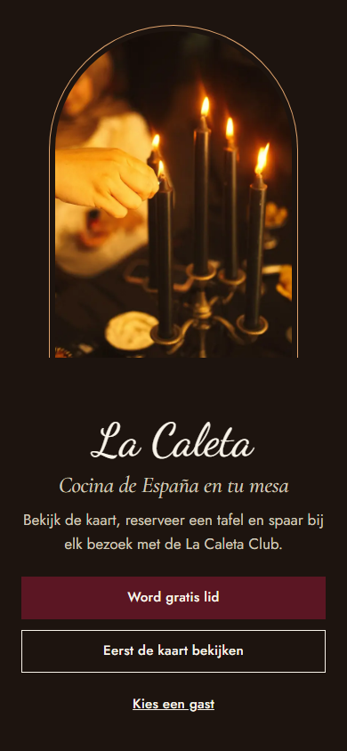
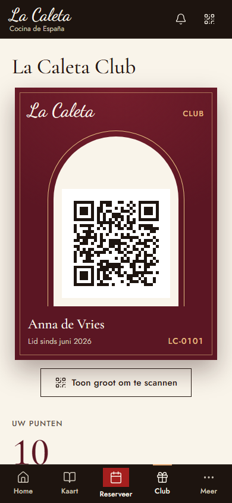
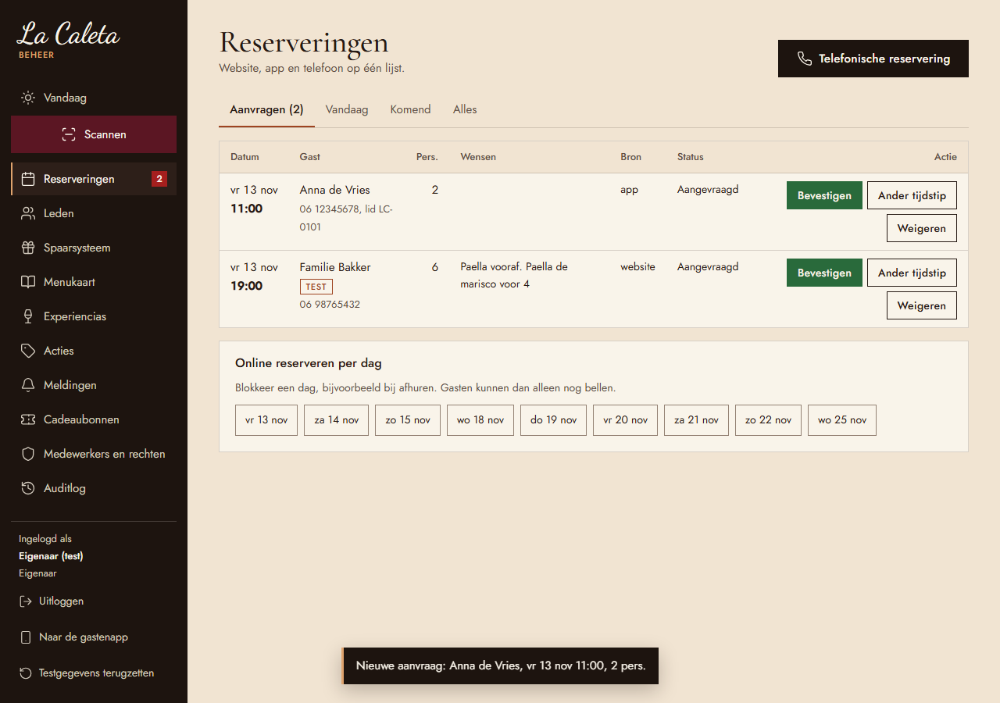

# La Caleta: The Guest Experience

**Live demo:** https://jalvdbroek-ship-it.github.io/la-caleta-app/

Gastenapp (PWA) en beheerpaneel voor Restaurant La Caleta in Rozenburg: digitale menukaart,
reserveren, de La Caleta Club met ledenkaart, QR-code en punten, experiences en cadeaubonnen.
Gebouwd op de huisstijl en de inhoud van de website in
`01-Websites-Klanten/Restaurant-La-Caleta`. Die website wordt niet aangeraakt.

**Stand: fase 1 en 2 klaar en goedgekeurd (12-11-2026). Volgende stap: fase 3, lokaal en zonder kosten.**
Keuzes: gedeelde reserveringsinbox voor website en app, eigen PostgreSQL in plaats van Supabase,
testfase op deze computer.
De preview is een klikbaar ontwerp met werkende logica in de browser, nog geen productie-app.

## Wat de app doet

De app start als een gast. Zonder account zie je meteen de menukaart, de openingstijden, de
tapasdag en het 12-uurtje, je kunt een tafel reserveren en je kunt gratis lid worden van de
La Caleta Club. Pas als je een gast kiest of lid wordt krijg je je punten, je persoonlijke aanbiedingen en je
cadeaubon. In het beheer kies je een rol: daar zie je reserveringen, leden, punten,
het menu, aanbiedingen, cadeaubonnen, wie wat mag doen en een logboek van alle acties.

## Een kijkje in de app

| Welkomstscherm | De Club | Beheer |
| --- | --- | --- |
|  |  |  |

## Waarom dit precies bij La Caleta past

- **De stijl is al van La Caleta.** Lettertypen, bordeaux, kaarslicht en de Spaanse sfeer komen
  uit de bestaande website. De gast herkent het restaurant direct, ook op zijn telefoon.
- **De kaart is echt.** Alle gerechten, prijzen, wijnen, openingstijden en de speciale momenten
  (tapasdag, seniorenmenu, 12-uurtje) komen uit de website. Er staat geen verzonnen gerecht of
  prijs in de app.
- **Reserveren gaat nu via telefoon en e-mail.** In de app komt dezelfde aanvraag in één gedeelde
  inbox binnen als de reserveringen via de website. Geen dubbele administratie, en de gast ziet
  direct of zijn tafel is bevestigd.
- **Vaste gasten worden vaker terug.** De Club geeft punten per bezoek, een QR-ledenkaart die de
  gast zelf laat scannen, en beloningen die zijn aandeel in de omzet vergroten.
- **Alles blijft bij La Caleta.** Eigen database, eigen servers, geen tussenpartij en geen
  abonnementskosten. De gastgegevens blijven in eigen hand, wat past bij de AVG.
- **Zonder app-installatie.** Het werkt als PWA: openen in de browser en later op het
  startscherm zetten als een gewone app, met een melding bij een bevestigde reservering.

## De preview openen

Live, ook op je telefoon:

    https://jalvdbroek-ship-it.github.io/la-caleta-app/

Lokaal:

```bash
cd La-Caleta-Gasten-App/02-Preview
python -m http.server 4190
```

Open http://localhost:4190/ . U ziet de app zoals een gast hem ziet: welkomstscherm, kaart,
reserveren en de Club. Alles werkt zonder account; voor de Club kiest u een gast of wordt u gratis lid.

Er is in deze demo geen login. Het beheer staat in de app onder **Meer, Beheer bekijken** (of
`beheer.html`) en vraagt welke rol u wilt bekijken: eigenaar, bedrijfsleider of bediening. Elke rol
ziet alleen wat hij mag. In de app kiest u onder **Gast kiezen** een testgast (Anna, Mohammed of
Joke) of u wordt zelf gratis lid. Wisselen kan altijd met "Andere rol kiezen" en "Van gast wisselen".

De wachtwoordcode (`logIn` en `staffLogIn` in `store.js`) blijft bestaan voor de echte versie; in fase 3
gebeurt het inloggen op de server (scrypt, sessies, tweestapsverificatie).

Voor een presentatie: `demo.html` zet gastenapp en beheer naast elkaar. De eigenaar kan in het
beheer "Testgegevens terugzetten" (alles staat in de localStorage van de browser).

## Mappen

| Map | Inhoud |
| --- | --- |
| `01-Documentatie/` | 1 onderzoeksrapport, 2 functioneel ontwerp, 3 technische architectuur, 4 visueel ontwerp, 5 ontwikkelplanning |
| `02-Preview/` | interactieve preview: `index.html` (start, opent de gastenapp), `gast.html`, `beheer.html`, `demo.html` (naast elkaar), `app/` (code), `assets/` |
| `03-Schermafbeeldingen/` | schermen op telefoon (390), tablet (820) en desktop (1280 en 1440) |
| `tools/` | `prep-assets.mjs` (foto's en kaart uit de website halen), `contrast.mjs` (kleurcontrast), `smoke.mjs` (browsertest) |

## Wat er echt is en wat een voorbeeld is

- **Echt, van de website:** alle gerechten, prijzen, categorieën, openingstijden, tapasdag,
  seniorenmenu, 12-uurtje, adres, telefoon, reserveringsregels. `02-Preview/app/site-data.js`
  wordt gegenereerd uit `src/data/site.ts` van de website: `node tools/prep-assets.mjs <website> 02-Preview`.
- **Voorbeeld:** spaarregels, beloningen, verjaardagscadeau, twee experiencias,
  cadeaubonbedragen, testleden en testreserveringen. Gasten zien geen labels; in het beheer
  staan ze gemarkeerd als "Voorbeeld" en als taak onder Vandaag.
- **In te vullen door La Caleta:** allergenen, nieuwe gerechten, ledenaanbiedingen,
  reactietijd op reserveringen, juridische teksten. Lege onderdelen zijn voor gasten verborgen.
  Volledige lijst in `01-Documentatie/01-Onderzoeksrapport.md` §1.8.
- **Foto's:** overgenomen van de website; de meeste zijn tijdelijk stockbeeld (zie `BEELD.md`
  van de website).

## Controle

```bash
node tools/contrast.mjs    # 22 kleurparen, alle WCAG AA
node tools/smoke.mjs       # met de server aan: 30 controles op stromen, rolkeuze, rechten en misbruik
```

De browsertest dekt: rolkeuze, scannen met realtime punten, dubbele scan, vervalste en verlopen
QR, wachttijd en overslaan met reden, rechten per rol, reserveren en bevestigen, validatie,
zoeken op de kaart, allergenen invullen, aanmelden en de ledenkaart. Niet getest: een echte
schermlezer, een echte camera-scan op een telefoon en installeren als app op iOS.

## Nog niet gebouwd

Alles uit fase 3 tot 7 in `01-Documentatie/05-Ontwikkelplanning.md`: database, echte accounts,
e-mail, pushmeldingen, betalen, hosting.
